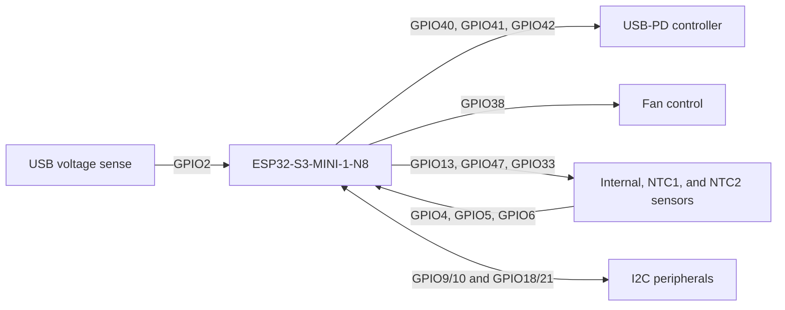

# Smart Fan Controller

A .NET nanoFramework application for the ESP32-S3-MINI-1-N8-based Radiator Fan
USB-PD Controller v1.2.

## Hardware pin configuration

`HardwareConfiguration` is the single source of truth for the controller's
pinout. `Program.Main` calls `ConfigurePins()` before any devices are created,
which routes the ADC and I2C signals to their ESP32-S3 peripheral functions.
GPIO direction and mode are configured when the associated GPIO device is
created.

The pinout below is transcribed from
`006650_Schematic_Radiator-Fan-USB-PD-Controller_V1.2.pdf`.



| Function | ESP32-S3 pin | Configuration |
| --- | ---: | --- |
| Status LED | GPIO1 | GPIO output |
| USB voltage sense | GPIO2 | ADC1 channel 1 |
| NTC1 temperature sense | GPIO4 | ADC1 channel 3 |
| NTC2 temperature sense | GPIO5 | ADC1 channel 4 |
| Internal NTC temperature sense | GPIO6 | ADC1 channel 5 |
| I2C bus 1 data / clock | GPIO9 / GPIO10 | I2C1 |
| NTC0 / NTC1 / NTC2 power | GPIO13 / GPIO47 / GPIO33 | GPIO outputs |
| I2C bus 2 data / clock | GPIO18 / GPIO21 | I2C2 |
| Fan control | GPIO38 | GPIO output |
| USB-PD CFG3 / CFG2 / CFG1 | GPIO40 / GPIO41 / GPIO42 | GPIO outputs |

The USB-voltage measurement is divided by the board's resistor network; apply a
factor of 11 to the ADC voltage to obtain the USB input voltage. The NTC supply
pins should be enabled only while sampling to avoid continuously powering the
thermistors.

## Requirements

- .NET SDK 8.0 or later
- nanoFramework firmware for the ESP32-S3, flashed to the board
- A serial connection to the board for firmware installation

Install the nanoFramework firmware flasher:

```sh
dotnet tool install --global nanoff
```

Put the board in download mode if required by its carrier board, then install
the ESP32-S3 Quad firmware (replace the serial port as appropriate):

```sh
nanoff --target ESP32_S3_QUAD --serialport COM3 --update
```

On Linux, the port is typically something like `/dev/ttyUSB0` or
`/dev/ttyACM0`. Check the nanoFramework ESP32-S3 target documentation and the
carrier board's instructions if a different firmware variant or boot procedure
is required.

## Build and deploy

Build the project from the repository root:

```sh
dotnet build
```

Open `SmartFanController.csproj` in Visual Studio with the nanoFramework
extension installed to deploy and debug the application over the device's
serial connection. The starter application writes a startup message to the
nanoFramework debug output and then remains running.
